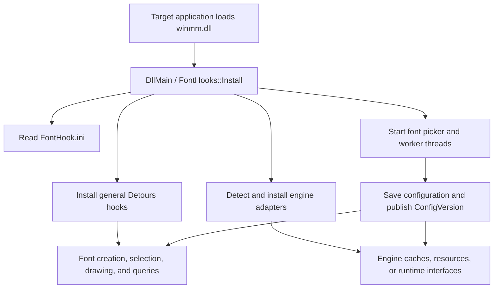

# Architecture

## Overall Structure

SimpleFontHook builds a proxy DLL named `winmm.dll`. After Windows loads the proxy,
`DllMain` calls `FontHooks::Install` to install general font hooks and matching
engine adapters. `winmm_proxy.h` forwards the system `winmm` exports. Font features
remain separate from proxy exports.

## Process Lifecycle

1. `DLL_PROCESS_ATTACH` disables thread-level DLL notifications and calls `FontHooks::Install`.
2. Installation reads configuration, prepares static adapter state, begins a Detours transaction, and installs hooks by category.
3. After the Detours transaction commits, it starts the Unity, Ren'Py, DirectWrite deferred-loading, and font picker threads.
4. UI configuration changes increment `Config::ConfigVersion`, clear general caches, and notify each engine adapter.
5. Normal shutdown stops worker threads and releases handles.
6. `DLL_PROCESS_DETACH` runs under the loader lock and only calls `Utils::RequestShutdown()` to publish a signal.

## Translation Unit Strategy

`hooks/font_hooks.cpp` is the aggregate translation unit for hook implementations.
`hooks/internal/**/*.cppinc` files are not compiled separately; they are included
in an explicit order. This keeps original API pointers, Detours targets, and engine
state at internal linkage, avoiding the exposure of large amounts of mutable
global state through headers.

The UI uses the same strategy: `ui/font_picker.cpp` aggregates state, drawing,
input, configuration application, and lifecycle fragments under `ui/internal/`.

## Module Interfaces

| Module | Public Interface | Hidden Implementation |
| --- | --- | --- |
| Process entry point | `FontHooks::Install` | Installation order, Detours transaction, and worker thread startup |
| Configuration | `Utils::LoadConfig`, `SaveConfig` | UTF-8 INI parsing, defaults, and compatibility key loading |
| Font replacement model | GDI/DirectWrite hook handlers | Replacement caches, logical font views, metrics, and glyph virtualization |
| Font table modification | `FontPatcher::*` | SFNT/TTC parsing, table rebuilding, and checksums |
| File adaptation | `engine_file_dispatch.cppinc` | Engine priorities, virtual attributes, and redirection |
| Engine adapters | Entry points such as `Install`, `Prepare`, and `NotifyConfigChanged` | Detection, cache location, runtime bridges, and resource generation |
| Font picker | `FontPicker::Init`, `Shutdown` | Window state, drawing, input, and font enumeration |

## Font Replacement and Encoding

Font replacement, charset spoofing, code page redirection, and character mapping
are four independent paths:

- Font replacement modifies font names, HFONTs, font data, or engine font resources.
- Charset spoofing modifies charsets exposed by font requests and font capability queries.
- Code page redirection modifies explicitly enabled `MultiByteToWideChar`/`WideCharToMultiByte` conversions.
- Character mapping maps decoded Unicode characters to target characters only when enabled.

ANSI character mapping first uses the charset detected during original font
creation. The replacement font's charset cannot determine source text encoding.
The configured `TextSubstitutionCodepage` is only a fallback when detection is
unavailable.

YU-RIS bitmap font adaptation replaces font resources. The adapter selects the
resource profile from the verified YPF archive contract, independently detects
directory encoding, then enumerates compatible page tables using the
188/192/160 slot byte layouts. It does not read an unpacked directory or
`ForcedCharset`, `TextSubstitutionCodepage`, or code page redirection settings.
The dedicated `YurisAtlasCodepage` overrides only page-table character mapping;
it does not change the resource layout. The fixed Big5 page table is decoded to
Unicode independently. Only when general character mapping is explicitly enabled
do rendered characters pass through the existing wide-character mapping.
Font replacement does not implicitly enable Traditional/Simplified Chinese conversion.

## Caches and Live Switching

`Config::ConfigVersion` is the version number of the runtime configuration snapshot.
Cache entries record the version at creation. Read paths accept only fonts, metrics,
and engine resources for the current version. General caches can be cleared
directly; engine caches refresh through hooks, messages, or runtime threads.

Do not use the font name as the sole condition for cache invalidation. Metrics,
charsets, character mapping, and font data can change even when the font name does not.

## High-Frequency Paths

Font creation, `SelectObject`, text drawing, glyph outlines, and file queries may
be called every frame. High-frequency paths may only read cached state, perform
bounded lookups, and call target APIs. Module scans, PE parsing, ASAR parsing,
font source parsing, required resource generation, and runtime type resolution
must be cached or moved to preparation or worker thread stages.

## Engine Adapters

Engine adapters cover rendering paths that GDI/DirectWrite cannot handle or
refresh internal engine font caches. An adapter must positively identify the
target environment through stable markers before performing expensive operations.
Detecting general font APIs proves only that an application uses fonts, not that
it belongs to a specific engine.

Identification separates identity, capabilities, and resource routing. Shared
extensions and filenames participate only in candidate resource classification.
Module markers, runtime interfaces, framework structures, or engine resources in
parsed archives confirm identity. An adapter handles corresponding file requests
only after confirming identity, preventing engines that share an extension from
entering one another's specialized logic.

### Three-Stage Decision Records

| Stage | Inputs | Allowed Evidence | Outputs |
| --- | --- | --- | --- |
| Identity | Main module, loaded modules, directories, and parsed containers | Combined strings, imports/exports, runtime framework structures, and engine-specific resources in containers | Confirmed identity or pass-through |
| Capabilities | Identity, version, format, and target API | Parseable table structures, export signatures, runtime types, and resource layouts | Installable capability set or fallback reason |
| Routing | Confirmed identity and one resource request | Normalized paths, container entries, resource types, and configuration snapshot | Original, virtual, or generated resource |

Each decision records `module`, `phase`, `decision`, `evidence`, `config_version`,
and `fallback`. High-frequency requests read only the identity and capability
caches. Static scans, archive parsing, and runtime type searches occur during preparation.

### From Evidence to Implementation

1. Fix the sample hash, architecture, build configuration, and `FontHook.ini` snapshot.
2. Record an API, file request, and rendering baseline with the adapter disabled.
3. Collect identity, capability, and routing evidence separately, labeling observations, inferences, and unconfirmed items.
4. Reduce the evidence to a minimum contract of inputs, preconditions, outputs, and failure behavior.
5. Implement the contract at the relevant detection, file dispatch, font resource, or runtime bridge boundary.
6. Execute the Win32/x64 verification matrix for positive, non-target, missing-capability, and boundary samples.

See [hooks/internal/engines/README.md](../SimpleFontHook/hooks/internal/engines/README.md)
for detailed rules. See [reproduction.md](reproduction.md) for evidence levels,
commands, and record templates.
